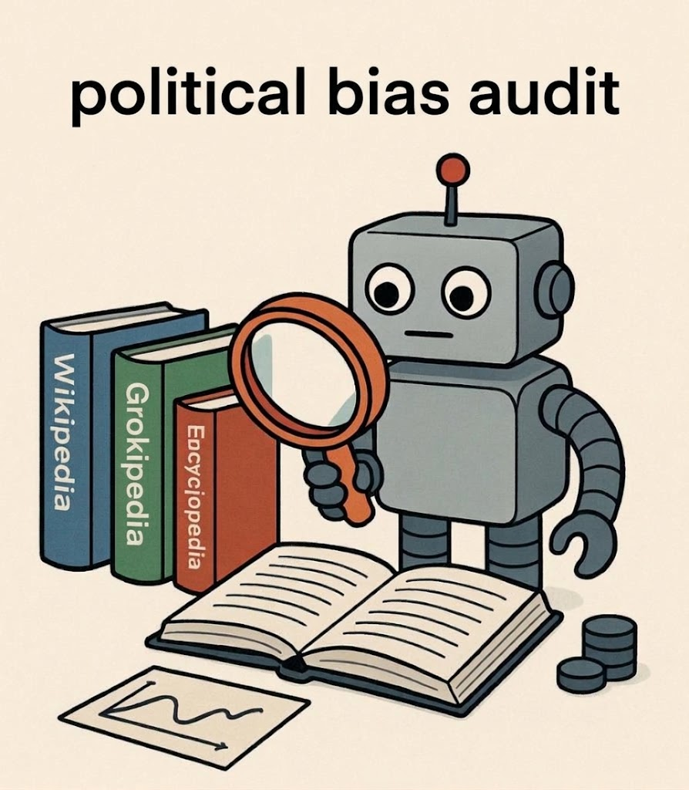
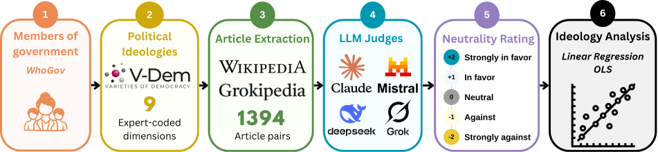

<h1 align="center">Encyclopedia Political Bias Audit</h1>

<p align="center">
  <a href="https://arxiv.org/abs/2607.15146"></a>
  <a href="https://huggingface.co/datasets/aida-ugent/encyclopedia-political-bias-audit"></a>
  <a href="LICENSE"></a>
</p>

<table>
  <tr>
    <td width="65%" valign="middle">
      <p>This repository contains the code for the paper <a href="https://arxiv.org/abs/2607.15146"><strong>Grokipedia <em>vs</em> Wikipedia: An LLM-Based Audit of Neutrality Across Political Ideologies</strong></a>.</p>
      <p>The study compares articles about <strong>1,394 politicians</strong>, linking expert-coded party ideology to neutrality assessments from <strong>Claude Opus 4.6, Grok 4, DeepSeek V4 Pro, and Mistral Medium 3.5</strong>.</p>
      <p>This repository provides article collection and cleaning, LLM auditing, statistical analysis, and figure generation.</p>
      <p>Read the <a href="https://arxiv.org/abs/2607.15146">paper</a> for the methodology and findings.</p>
    </td>
    <td width="35%" align="center" valign="middle">
      
    </td>
  </tr>
</table>

##

<p align="center">
  
  <br>
  <em>Figure 1. Methodology overview: politician selection, ideology matching, article collection, LLM neutrality assessment, and statistical analysis.</em>
</p>

## 🚀 Getting started

Use **Python 3.12**. Run commands from the repository root unless otherwise indicated.

```bash
python -m venv .venv
source .venv/bin/activate
pip install -r requirements.txt
cp .env.example .env
export WANDB_MODE=offline
```

To run new audits, set `ANTHROPIC_API_KEY`, `XAI_API_KEY`, and `DEEPSEEK_API_KEY` in `.env`. Analysing saved ratings requires no API keys.

Mistral runs locally and requires hardware capable of loading the 128B model. Configure the judges to run in [`src/llm_experiments/config/models.py`](src/llm_experiments/config/models.py). API and local judges can run on separate machines.

## 🗂️ Repository structure

```text
assets/                                  # README illustration
notebooks/
  data_collection.ipynb                   # WhoGov–V-Party matching
  leaders_article_post_processing.ipynb   # Article cleaning and country map
src/
  data_collection/                       # Wikipedia and Grokipedia collection
  llm_experiments/                       # Neutrality prompt, model clients, runners
  analysis/statistical_analysis/         # Regressions, robustness, tables, figures
human_study/
  build_tasks.py                         # Validation sampling and data loading
  build_survey.py                        # Survey item definitions
  power_analysis.py                     # Precision planning and agreement metric
  result_analysis/                      # Human validation and reliability analysis
```

## 📚 Data

[Hugging Face](https://huggingface.co/datasets/aida-ugent/encyclopedia-political-bias-audit) provides articles, ideology scores, ratings, explanations, and party/country/year metadata. Paths below cover preparation and analysis; notebooks regenerate intermediates from upstream downloads. Analysis scripts require reshaping the export.

| Path | Contents |
| --- | --- |
| `data/LeadersAndParties/WhoGov_within_V3.1.csv` | WhoGov v3.1 government-member records |
| `data/LeadersAndParties/V-Dem-CPD-Party-V2.csv` | V-Party v2 ideology scores |
| `data/LeadersAndParties/leaders.csv` | Matched politician and ideology metadata |
| `data/LeadersAndParties/parties.csv` | Party metadata used in staleness checks |
| `data/articles/LeadersAndParties/leaders.csv` | Article snapshots before cleaning |
| `data/articles/LeadersAndParties/leaders_processed.csv` | Cleaned study corpus |
| `results/final2.0/{api,local,batch}/ideology/.../results.csv` | Saved neutrality ratings from the four judges |

The study corpus contains **1,394 article pairs** and **11,152 ratings**. Keep the study snapshots when reproducing published results: the cleaning rules include manually reviewed article matches tied to those snapshots.

## 📊 Reproduce the analysis

With the processed corpus and saved ratings in place:

```bash
# Descriptive statistics and figures
python -m src.analysis.statistical_analysis.main --results-path results/final2.0 --descriptive-only

# Full statistical pipeline
python -m src.analysis.statistical_analysis.main --results-path results/final2.0

# Main-paper figures
python -m src.analysis.statistical_analysis.combined_coefplot --results-path results/final2.0 --save-path results/figures/ols/combined.pdf
python -m src.analysis.statistical_analysis.facct_score_distribution

# Descriptive tests and identification checks
python -m src.analysis.statistical_analysis.descriptive_tests --results-path results/final2.0
python -m src.analysis.statistical_analysis.run_identification --results-path results/final2.0
```

The pipeline estimates Wikipedia-minus-Grokipedia and per-source models, with standardised ideology covariates and party-clustered standard errors. It also produces ordinal-model comparisons and robustness checks. Outputs are written to `figures/` and `tables/` under the selected results directory unless an output path is specified.

The paper's distribution figure uses `results/final2.0/` and checks the published neutral-rating shares. Those checks may fail for a newly collected audit.

## 🌐 Collect and prepare articles

Collection has three stages: build the politician list, fetch article text, and clean the matched corpus. The article collector uses public web endpoints and a Hugging Face dataset; LLM API keys are needed only for the subsequent audit.

### 🧩 1. Prepare the politician and ideology metadata

Place the **WhoGov v3.1** and **V-Party v2** CSV files at the paths listed in the Data section. These two inputs must be obtained separately; the notebook does not download them. Then run:

```bash
cd notebooks
jupyter nbconvert --to notebook --execute --inplace data_collection.ipynb --ExecutePreprocessor.timeout=-1
cd ..
```

The notebook selects government members observed from 2016 onward, keeps each person's latest record, and matches their party and country to the nearest available V-Party observation year. It writes:

- `data/LeadersAndParties/leaders.csv`: politician names, country and party identifiers, demographic metadata, and ideology scores.
- `data/LeadersAndParties/parties.csv`: party metadata used by the analysis.

### 📥 2. Fetch Wikipedia and Grokipedia articles

From the repository root, run:

```bash
python src/data_collection/article_collector.py
```

The collector reads the unique names in `data/LeadersAndParties/leaders.csv` and retrieves the following text for each matched politician:

| Source | Retrieval method | What is fetched |
| --- | --- | --- |
| Wikipedia | English Wikipedia MediaWiki API through `mwapi` | Candidate pages are searched and ranked against name variants. Redirects are resolved, list/disambiguation pages are rejected, and article-body wikitext is fetched. Markup is stripped and text is cut at boilerplate headings such as References or See also. |
| Grokipedia 0.2 | HTTP requests and BeautifulSoup parsing | Live article HTML from `https://grokipedia.com/page/<title>`. The scraper tries the politician's name and resolved Wikipedia-title variants, then extracts the article text. |
| Grokipedia 0.1 | Hugging Face `datasets` | Article text from `htriedman/grokipedia-v0.1-dump`, matched by normalised title. A lookup index is cached at `data/cache/groki_index.pkl` after the first download. |

Output is appended to `data/articles/LeadersAndParties/leaders.csv`, with columns `name`, `wikipedia`, `grokipedia_0_1`, and `grokipedia_0_2`. A row requires a Wikipedia article and at least one Grokipedia version; the cleaning stage subsequently selects the Wikipedia–Grokipedia 0.2 pairs used in the study.

Collection uses parallel workers, rate limiting, retries, and a checkpoint at `data/articles/LeadersAndParties/leaders.checkpoint.json`. Rerun the same command to resume from an existing checkpoint. Titles already recorded as attempted, including unsuccessful matches, are skipped. Rate limits, worker count, and retry settings are configured in [`src/data_collection/config.py`](src/data_collection/config.py).

Use a separate working copy for a fresh collection: the collector appends to an existing output CSV, and live pages may differ from the frozen study snapshots.

### 🧹 3. Clean and filter the paired corpus

Once collection is complete, run:

```bash
cd notebooks
jupyter nbconvert --to notebook --execute --inplace leaders_article_post_processing.ipynb --ExecutePreprocessor.timeout=-1
cd ..
```

The cleaning notebook joins article text to politician metadata, requires at least **300 words in each Wikipedia and Grokipedia 0.2 article**, and applies occupation-keyword, birth-year, and manually reviewed identity checks. It removes missing ideology annotations, transforms the ideology scales, and cleans article text and appended references. Manual match decisions correspond to the study snapshots and should be reviewed for a newly collected corpus.

The outputs are `data/articles/LeadersAndParties/leaders_processed.csv`, ready for the LLM audit and statistical analysis, and the country map at `results/figures/appendix/countries.png`. Cartopy may download map assets on first use.

## 🤖 Run a new LLM audit

```bash
# Submit batch jobs and run configured API/local judges
python src/llm_experiments/run_experiments.py submit

# Monitor and retrieve batch results
python src/llm_experiments/run_experiments.py status --run-id RUN_ID
python src/llm_experiments/run_experiments.py retrieve --run-id RUN_ID

# Retrieve all completed runs
python src/llm_experiments/run_experiments.py retrieve --all

# Resume an interrupted synchronous run
python src/llm_experiments/run_experiments.py submit --resume results/TIMESTAMP_RUN_ID
```

Each politician's article is assessed once per source and judge. The neutrality audit uses the identifier `ideology` in output paths. API and local results are saved incrementally; retain batch submission metadata until retrieval completes.

Runs are stored under `results/TIMESTAMP_RUN_ID/`. When running judges separately, combine their `api/ideology/`, `local/ideology/`, and `batch/ideology/` directories under one results root, avoiding duplicate ratings.

## 📄 License

This project is licensed under [Creative Commons Attribution 4.0 International](LICENSE). Third-party datasets and article texts retain their respective licenses.

## 📖 Citation

If you use this code or build on the study, please cite:

```bibtex
@misc{vlahos2026grokipediavswikipediallmbased,
      title={Grokipedia vs Wikipedia: An LLM-Based Audit of Political Neutrality along Ideologies},
      author={Filippos Vlahos and Guillaume Bied and Tijl De Bie},
      year={2026},
      eprint={2607.15146},
      archivePrefix={arXiv},
      primaryClass={cs.CL},
      url={https://arxiv.org/abs/2607.15146},
}
```

## 👥 Authors

| Author | Affiliation | Contact |
| --- | --- | --- |
| Filippos Vlahos (corresponding author) | Ghent University, Ghent, Belgium | [filippos.vlahos@ugent.be](mailto:filippos.vlahos@ugent.be) |
| Guillaume Bied | Ghent University, Ghent, Belgium | — |
| Tijl De Bie | Ghent University, Ghent, Belgium | — |
